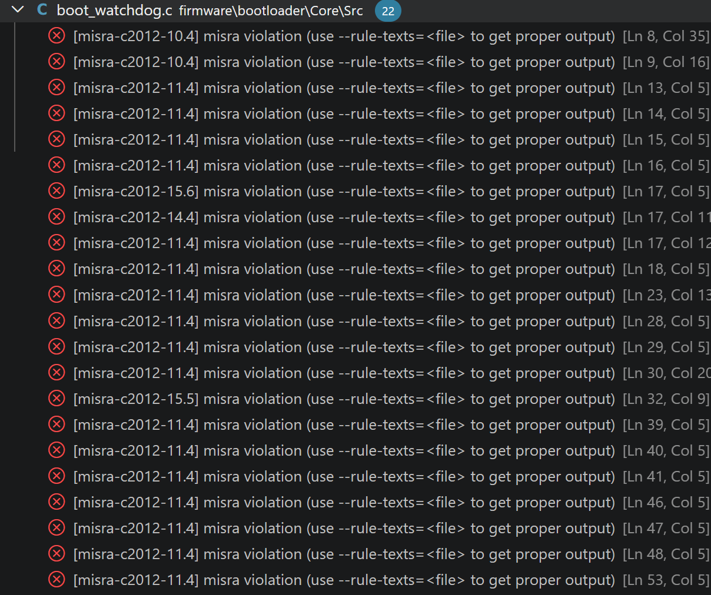

# MISRA-C 검증 및 리팩토링
## 전체 예외 처리 룰
- 하드웨어 메모리 맵 레지스터 접근 허용: IWDG->KR = IWDG_KEY_ENABLE 등 물리 주소 접근을 위해 필수적인 코드 (Rule 11.4)
- 다중 리턴 허용: 코드 가독성을 위해 허용 (Rule 15.5)
- 표준 라이브러리 메모리 조작 함수 반환값 미사용 허용: memcpy, memset의 반환값(포인터)은 로직상 불필요함 (Rule 17.7)
## boot_watchdog.c
### 개요

- 초기 위반 건수: 22건 (주요 규칙: Rule 10.4, 11.4, 14.4, 15.5, 15.6)
- 조치 결과: 수정: 4건, 예외 처리 18건

### 주요 리팩토링 내역
- 부호 없는 정수 접미사 U 누락 3건 (Rule 10.4)
- 레지스터 업데이트 대기 while문에 중괄호 누락 1건 (Rule 15.6)

### 예외 처리 내역
- ST HAL 매크로의 do-while(0U)로 인한 예외(Rule 14.4)
- 단일 파일 검사 시 발생하는 오탐 (Rule 8.7)