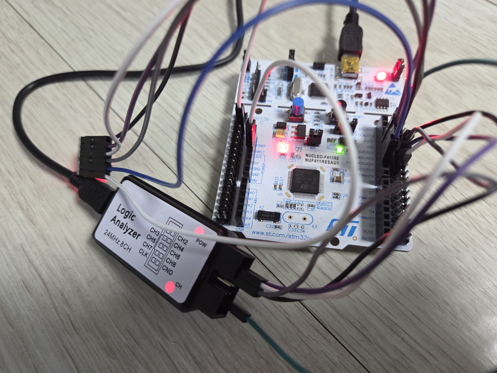
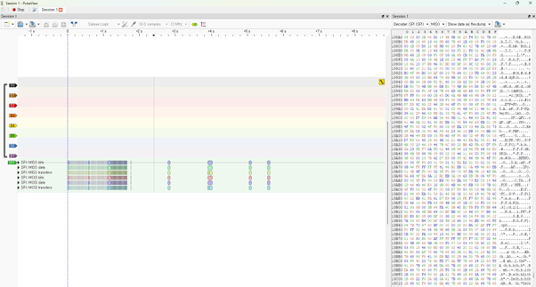
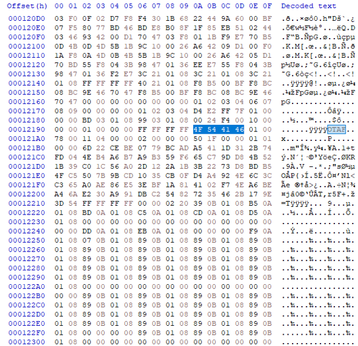
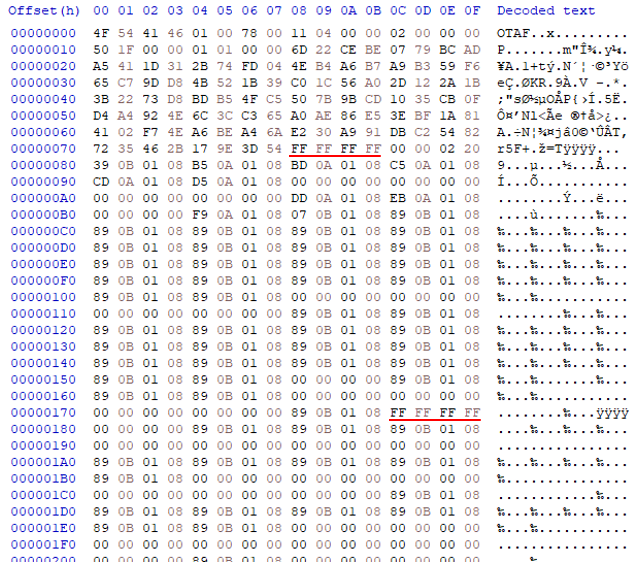
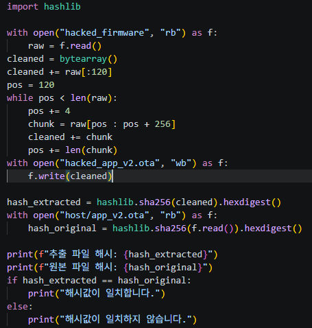
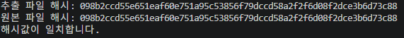
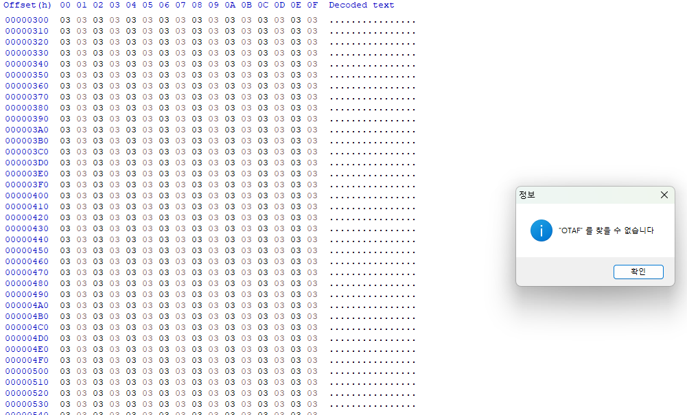

# [취약점 보고서] 외부 SPI Flash 버스 스니핑을 통한 평문 펌웨어 탈취 취약점

## 1. 취약점 개요
* **취약점 명**: 외부 SPI Flash 버스 스니핑을 통한 평문 펌웨어 탈취
* **취약점 분류**: CWE-319 (Cleartext Transmission of Sensitive Information), CWE-312 (Cleartext Storage of Sensitive Information)
* **대상 기능**: OTA 펌웨어 업데이트 및 롤백 기능
* **위험도**: **High** (기밀성 영향: 펌웨어 바이너리 유출로 인해 지적 재산권 탈취 및 리버스 엔지니어링 가능)
* **요약**: OTA 패킷 자체는 암호화되어 전송되나, MCU가 복호화한 펌웨어를 외부 SPI Flash(W25Q64)에 평문으로 저장하고 이를 읽어오는 과정에서 평문 펌웨어 전체가 탈취될 수 있는 취약점입니다.

## 2. 취약점 재현 (PoC)



### 1. 캡처 환경 구성
- STM32 MCU와 외부 SPI Flash(W25Q64) 간의 통신 라인 및 GND에 USB 로직 분석기를 연결합니다.
- `ota_pack.py`, `ota_encrypt.py`를 통해 암호화된 ota바이너리 파일을 만듭니다.
- SPI 디코더(Mode 0, MSB First)를 설정하고 캡처를 시작한 뒤, PC에서 암호화된 OTA 패키지(이하 `app_v2_enc.bin`) 전송을 수행합니다.
```powershell
python host/ota_pack.py --input firmware/testapp/Debug/TestApp.bin --output host/app_v2.ota --version 2 --key keys/test_privkey.pem && python host/ota_encrypt.py --input host/app_v2.ota --output host/app_v2_enc.bin && python host/ota_send.py --port COM3 --package host/app_v2_enc.bin
```


### 2. 복호화 후 내부 플래시 설치 구간의 평문 식별
- 암호화 패킷 수신이 완료된 직후, 부트로더가 복호화된 펌웨어를 읽어 내부 플래시로 설치하는 구간의 SPI 트래픽을 확인합니다.
- MISO 라인에서 OTA 헤더의 고유 매직 넘버인 OTAF (`0x4F 0x54 0x41 0x46`)로 시작하는 평문 스트림을 확인하고 해당 트래픽 전체를 덤프합니다.



### 3. SPI 통신 프로토콜 더미 데이터 제거
- W25Q64 데이터 읽기(`W25Q64_ReadData`) 과정에서, STM32가 4바이트의 읽기 명령어 및 주소를 전송하는 동안 MISO 라인에는 풀업 상태인 `0xFF 0xFF 0xFF 0xFF` (4바이트 더미)가 주기적으로 삽입됩니다.
- 따라서 120바이트 헤더 이후 256바이트 페이로드마다 삽입된 4바이트 더미 데이터를 파싱 스크립트([`parsing_firmware.py`](./parsing_firmware.py))로 제거합니다.



### 4. 탈취 바이너리와 원본 펌웨어의 무결성 대조
- 더미 데이터가 제거된 추출 바이너리 파일과 빌드 시 생성된 원본 펌웨어의 SHA-256 해시를 비교합니다.
- 두 파일의 해시값이 일치함을 통해 펌웨어 탈취가 가능함을 보입니다.

## 3. 취약점 원인 분석 (Root Cause)
### 1. 설치 펌웨어 평문 보관
- OTA 전송 구간은 암호화되어 보호되지만, 복호화 결과물이 물리적 보안 경계(Hardware Security Boundary) 바깥에 위치한 외부 SPI Flash의 `EXT_FLASH_DEC_ADDR (0x100000)`에 평문으로 기록됩니다.
### 2. 백업 펌웨어 평문 보관
- 롤백 지원을 위해 현재 펌웨어를 백업할 때도 `EXT_FLASH_BACKUP_ADDR (0x200000)`에 암호화 없이 평문 그대로 기록됩니다.
### 3. 물리적 버스 보호 부재
- STM32와 외부 Flash 간의 SPI 신호선은 PCB 패턴이나 핀으로 외부 노출되어 있어, 별도의 특수 장비 없이 저가형 USB 로직 분석기 등을 통해 실시간 도청이 가능합니다.

## 4. 취약점 해결
### 1. 외부 Flash A/B 슬롯 도입 및 평문 저장소 제거
- 기존에 복호화된 평문을 임시 보관하던 스테이징 영역(EXT_FLASH_DEC_ADDR)과 평문 백업 영역(EXT_FLASH_BACKUP_ADDR)을 코드상에서 완전히 제거하였습니다.
- 대신 외부 Flash를 Slot A (0x000000)와 Slot B (0x100000) 2가지 슬롯을 사용하도록 변경하여, UART로 수신된 암호화된 OTA 패키지만 번갈아 가며 저장하도록 하였습니다.
- 이를 통해 외부 Flash 내부에는 평문 펌웨어가 아예 저장되지 않습니다.

### 2. 복호화 내부 플래시 직접 기록
- 외부 Flash에서 평문을 풀어 쓰는 중간 단계를 제거하였습니다.
- 설치 시 외부 Flash 슬롯에서 256바이트 단위로 펌웨어 암호문을 읽어옵니다.
- 읽어온 암호문은 보드 내부 버퍼에서만 복호화를 수행하며, 복호화 즉시 내부 플래시에 기록됩니다.
- 복호화 및 쓰기 작업이 끝나면 SRAM에 남아 있는 키를 즉시 파기합니다.

### 3. 암호화 슬롯 기반 롤백
- 펌웨어 실행 실패나 검증 실패로 롤백이 발생할 때도 암호화된 펌웨어를 통해 롤백을 수행합니다.
- 펌웨어 업데이트 시에는 기존에 정상 작동하던 펌웨어 패키지가 보관된 반대편 슬롯을 대상으로 펌웨어 설치를 수행합니다.
- 만약 롤백이 발생하면, 기존에 정상 작동하던 펌웨어 패키지가 보관된 슬롯을 대상으로 복호화 및 내부 플래시 설치를 통해 롤백을 합니다.

### 4. 테스트

- 펌웨어가 암호화된 채로 외부 플래시에 저장되므로 캡처된 패킷에서 'OTAF'가 식별되지 않습니다.